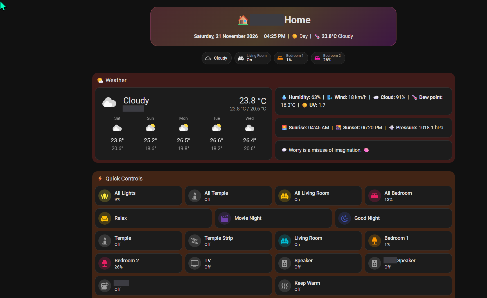
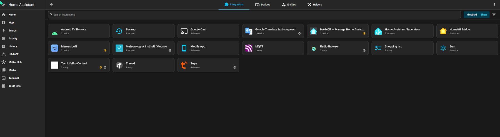
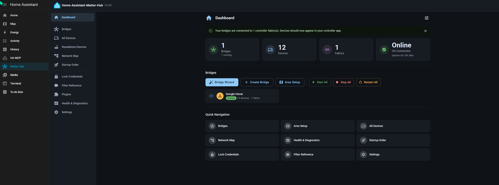
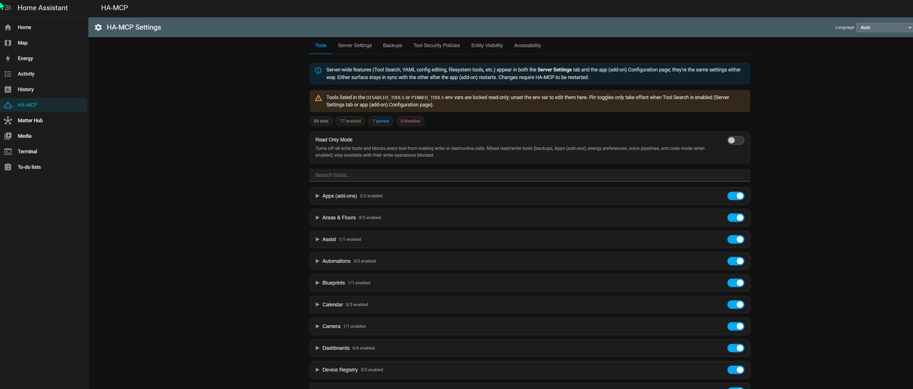
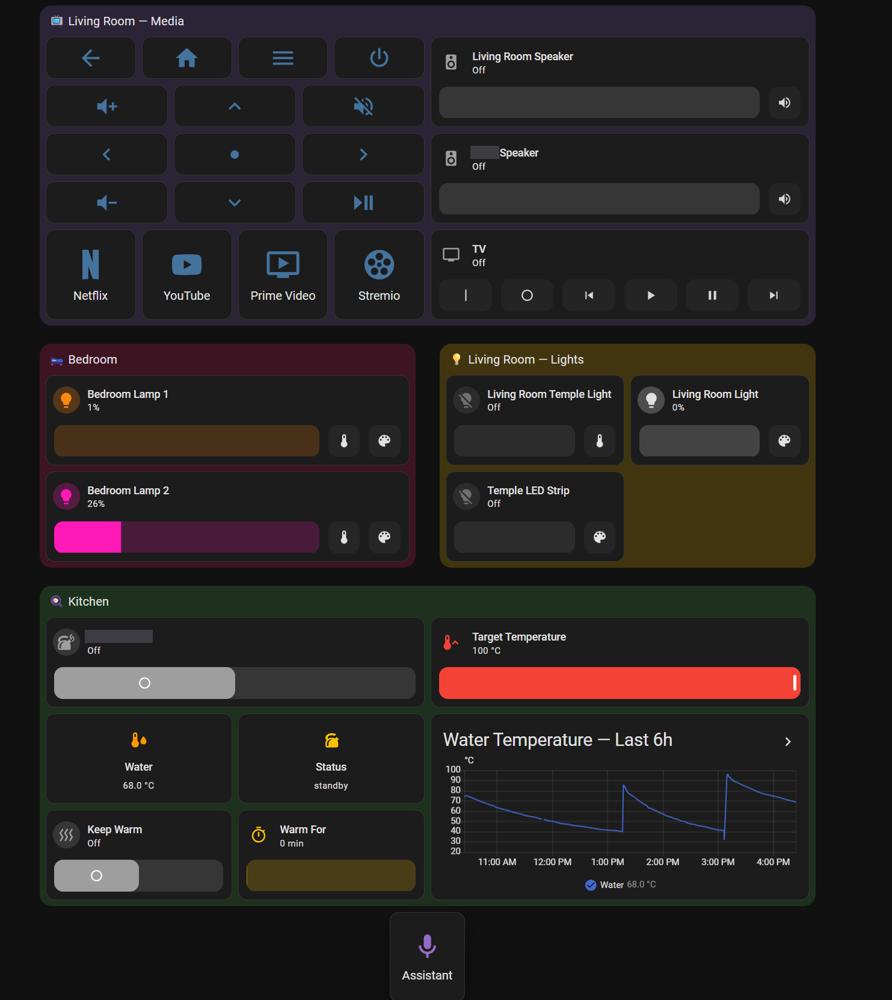

# Home Assistant

**Home Assistant OS** running as a VM on my Proxmox cluster. It controls the lights, TV, speakers and kitchen appliances. Every device also shows up in **Google Home** through a Matter bridge, and Claude can manage the setup through an MCP server add-on.

---

## Contents
1. [The VM](#1-the-vm)
2. [Integrations and devices](#2-integrations-and-devices)
3. [Google Home through Matter Hub](#3-google-home-through-matter-hub)
4. [HA-MCP: managing Home Assistant with AI](#4-ha-mcp-managing-home-assistant-with-ai)
5. [The dashboard](#5-the-dashboard)
6. [Monitoring and backups](#6-monitoring-and-backups)
7. [Lessons learned](#7-lessons-learned)

---

## 1. The VM

| Setting | Value |
|---|---|
| OS | Home Assistant OS (the official appliance image) |
| Firmware | UEFI (OVMF) - required by HA OS |
| CPU / RAM / disk | 2 vCPU, 6 GB, 32 GB |
| Guest agent | Enabled: Proxmox shows the IP, shuts it down cleanly, and reports real memory use |
| Network | Bridged to the LAN with a DHCP reservation (Matter, Cast and HomeKit discovery need the same network as the devices) |

The usual way to create it is the community "Home Assistant OS VM" script on a Proxmox node, which downloads the latest HA OS image, creates the UEFI VM and imports the disk.

## 2. Integrations and devices

| Integration | Devices |
|---|---|
| **Tuya** | Smart bulbs and LED strip (temple lights, lamps) |
| **Meross LAN** (HACS) | Smart plug, controlled locally without the cloud |
| **Android TV Remote** | Google TV streamer: power, d-pad, volume, launching Netflix / YouTube / Prime Video / Stremio |
| **Google Cast** | Nest speaker, sound bar, TV for media and announcements |
| **TechLife Pro Control** (custom) | Smart kettle: on/off, target temperature, keep-warm, live water temperature |
| **HomeKit Bridge** | Exposes selected devices to Apple Home |
| **MQTT**, **Thread** | Device transport |
| **Met.no** | Weather |
| **Mobile App** | Phones as presence sensors and notification targets |
| **Google Translate TTS**, **Radio Browser**, **Shopping list**, **Sun**, **Backup** | Built-ins |

## 3. Google Home through Matter Hub

The **Home-Assistant-Matter-Hub** add-on publishes Home Assistant entities as a **Matter bridge**. Google Home pairs with the bridge once (scan the QR code) and then sees all 12 devices, with voice control ("Hey Google, turn off the temple light"), even for devices that have no Google integration of their own.

1. Add the add-on repository and install **Home-Assistant-Matter-Hub**.
2. Open its UI → **Bridge Wizard**, choose which entities (or areas) to expose.
3. In Google Home: **Add → Matter-enabled device**, scan the bridge's QR code.
4. **Area Setup** maps HA areas to rooms in Google Home.

## 4. HA-MCP: managing Home Assistant with AI

The **HA-MCP** add-on runs a [Model Context Protocol](https://modelcontextprotocol.io) server inside Home Assistant, so an AI assistant can read states and create or edit automations, scripts, dashboards and helpers. The add-on lets you switch individual tool groups on or off, enable a **read-only mode**, and set security policies for which entities are visible.

Changes made through MCP are still reviewed in HA before they're kept, and read-only mode is there for when you only want answers.

## 5. The dashboard

A single-page Lovelace dashboard, laid out by room:

- **Header:** date, time, day/night, weather; chips for room status.
- **Weather:** 5-day forecast, humidity, wind, UV, sunrise/sunset, a daily quote.
- **Quick controls:** all lights / per room, scenes (**Relax**, **Movie Night**, **Good Night**), TV, speakers, kettle.
- **Living Room: Media:** a full TV remote (d-pad, volume, power) and one-tap app launchers, plus speaker volume.
- **Bedroom / Living Room lights:** brightness, colour temperature and colour per bulb.
- **Kitchen:** kettle on/off, target temperature, keep-warm, and a 6-hour water-temperature graph.
- **Assistant:** voice assistant button.

## 6. Monitoring and backups

- **Zabbix** checks the web UI every minute and Proxmox reports the VM's memory. An alert fires above 90 % ([zabbix-monitoring](https://github.com/nashibbhattrai766-max/zabbix-monitoring)).
- The whole VM is backed up nightly to **Proxmox Backup Server**. HA's own Backup integration is also enabled for app-level restores.

## 7. Lessons learned

- **Memory grows with add-ons.** With Matter Hub and HA-MCP running, the VM sits near 90 % of its 6 GB. Check memory after adding add-ons.
- **Enable the guest agent.** Without it, a Proxmox shutdown of the VM timed out and had to be done from inside HA; with it, shutdowns are clean.
- **Keep HA on the same network as the devices.** Cast, Matter and HomeKit discovery rely on multicast.

## License

MIT
